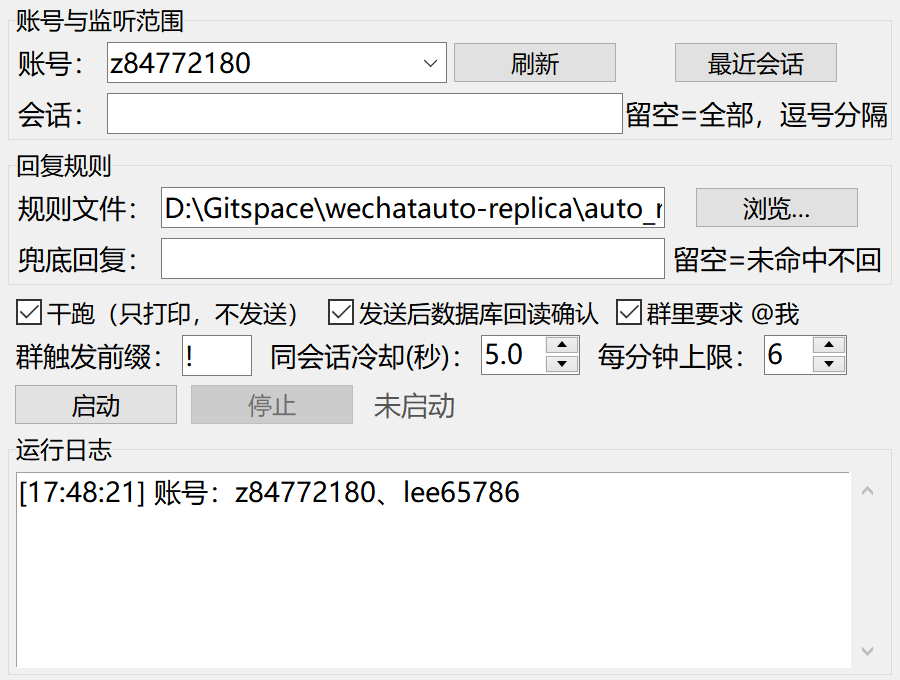

# 自动回复接入指南（wechatauto-replica）

> 适用：微信 4.x Windows 桌面端，已登录。读消息走本地数据库，回复走 UIA/OCR 驱动真实客户端。
> 本文对应仓库新增的 `wechatauto/demo_auto_reply.py`。

## 1. 环境

```powershell
conda activate localgpt          # Python 3.10（本机验证）
pip install -e ".[guia]"
python -m wechatauto doctor      # 账号 / DB 密钥 / 图片密钥 / 控件树
```

本机安装时踩过两个坑（已修好，重装时注意）：

- 环境里的 `numpy 1.25.2` 元数据损坏 → `pip` 装 `opencv-python` 会要求 numpy 2，
  直接升级会波及其它依赖。做法：修好 numpy 的 dist-info 后装
  `opencv-python==4.9.0.80`（兼容 numpy 1.x）。
- `Pillow` 安装不完整（`from PIL import Image` 报 unknown location）→
  `pip install --force-reinstall --no-deps Pillow==10.0.0`。

## 2. 先干跑，不要一上来就发

```powershell
python -m wechatauto.demo_auto_reply --chat 姚浩宇 --dry-run
```

`--dry-run` 只做数据库监听 + 规则匹配，**不点微信窗口**；命中时打印「将回复 …」。

规则可直接写在 JSON 里（见 `auto_reply_rules.example.json`）：

```json
{
  "group_prefix": "!",
  "group_require_mention": true,
  "default_reply": "",
  "rules": [
    {"match": ["你好", "hi"], "reply": "你好，我是自动回复机器人～"},
    {"match": ["几点", "时间"], "reply": "现在是 {time}。"},
    {"match": ["^/ping$"], "regex": true, "reply": "pong"}
  ]
}
```

`match` 支持子串 / 正则（`regex: true`）/ 整句（`exact: true`）；
`reply` 支持 `{sender}`、`{chat}`、`{content}`、`{time}`。
`chats: ["wxid_xxx"]` 可把一条规则限定到指定会话。

## 2.5 图形界面（不想敲命令就用这个）



双击仓库根目录的 **`启动自动回复.bat`**，或者：

```powershell
conda activate localgpt
cd D:\Gitspace\wechatauto-replica
python -m wechatauto.auto_reply_gui
```

界面用法：

1. 账号下拉框选要挂的号（多开时这里会列出多个，选哪个就只读/只发哪个）；
2. 「会话」留空 = 全部会话；只想盯某个群/某个人就填昵称或群名，多个用英文逗号；
3. 规则文件默认已指向 `auto_reply_rules.example.json`，可点「浏览…」换；
4. **先保持「干跑」勾选**，点「启动」，看日志里有没有「命中：… -> …」；
5. 确认规则对了，取消「干跑」再点「启动」——这次才会真正发微信；
6. 点「停止」结束；关窗口也会停。

> 界面只是把 CLI 的参数搬到按钮上，发送链路、节流、回读确认完全一样。

## 3. 真正回复

```powershell
# 监听指定会话（昵称/备注/群名/wxid 都行）
python -m wechatauto.demo_auto_reply --chat 姚浩宇 --rules auto_reply_rules.json

# 多开：指定账号 + 账号自己的窗口（不指定 --hwnd 时按账号目录自动找）
python -m wechatauto.demo_auto_reply --account lee65786_a6d5 `
    --chat 红红火火群 --rules auto_reply_rules.json

# 监听全部会话，未命中给兜底
python -m wechatauto.demo_auto_reply --all --rules auto_reply_rules.json --default-reply "稍后回复你"

# 群里只回 @我 或 "!命令"
python -m wechatauto.demo_auto_reply --all --rules auto_reply_rules.json
```

### 默认行为（安全阀）

| 行为 | 默认 | 说明 |
|---|---|---|
| 只回文本 | ✅ | 图片/语音/文件/表情不触发 |
| 不回自己 | ✅ | `sender_username == 本机 wxid` 直接丢弃（含手机端同步） |
| 不回公众号 | ✅ | `gh_*`、`@openim`、`filehelper` 等 |
| 群聊要求 @ | ✅ | 只认 `@本机昵称`；也可用 `!` 前缀触发（`--group-prefix`） |
| 旧消息不回 | 180s | `--max-age 0` 关闭 |
| 同会话冷却 | 5s | `--cooldown` |
| 每分钟上限 | 6 条 | `--max-per-minute` |
| 发送确认 | ✅ | `verify=True` 从数据库回读；**未确认不重发**（防重复） |

拟人节奏由库统一控制（默认 `natural`：写动作间隔 2.5–6s、120s 内 6 次）。
想临时快一点：`$env:WECHATAUTO_RHYTHM="fast"`；默认档位不要改成 `off`。

## 4. 接入 AI（可选）

`AutoReplier.handle()` 里 `reply_tpl = self.rules.match(...)` 是唯一决定回复内容的地方。
接 AI 的思路：

1. 在 `handle()` 里把 `text_for_match` 交给你的模型（本地 Ollama / 云端 API 均可）；
2. **不要在回调线程里同步等模型**——回调线程只负责入队；
   模型调用放到发送线程或单独的 worker，再把结果 `sender.submit(...)`；
3. 给模型加超时（如 20s）和兜底话术，超时就回兜底，别让队列堆死。

## 5. 排错

| 现象 | 原因 / 处理 |
|---|---|
| 报「找不到微信主窗口」 | 微信没启动/在登录页；脚本只认 `Weixin.exe` 的主窗，不会误绑标题带「微信」的 Chrome |
| 发送失败/未确认 | 微信窗口被锁屏、最小化到托盘、或 UIA 被重置；重跑一次，或先 `wechatauto doctor` |
| 第一次查询很慢（30s~2min） | 大库首次解密，属正常；之后走增量 WAL 合并（本仓库已修） |
| 提示数据库重建 | 删 `%TEMP%\wechatauto_db\<账号>` 可强制重建；不要在解密中途杀进程 |
| 回复发错人 | 显示名重名时 `open_chat` 可能歧义；用 wxid 明确目标，并保持 `verify=True` |

## 6. 已知限制

- 微信必须**已登录且窗口可操作**；锁屏/远程桌面断开时发送会失败。
- 群聊回复目前是普通文本，**不是真正的 @ 提醒**（真 @ 需要点选成员弹层，稳定性不足）。
- 发送会移动/置顶微信窗口，并在发送结束后还原被最小化的遮挡窗口。
- 自动回复属于写操作，账号风控风险由使用者承担；建议小号先验证。
